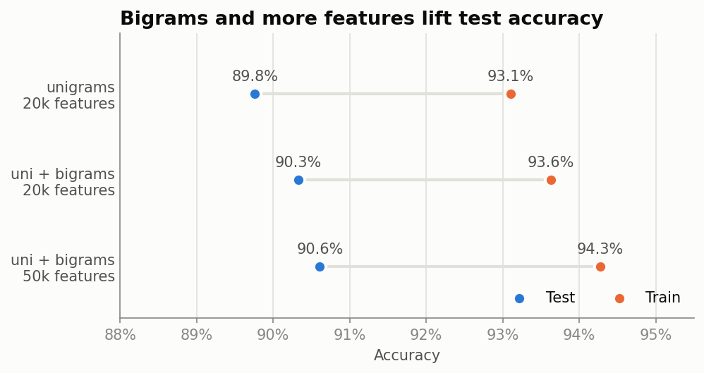
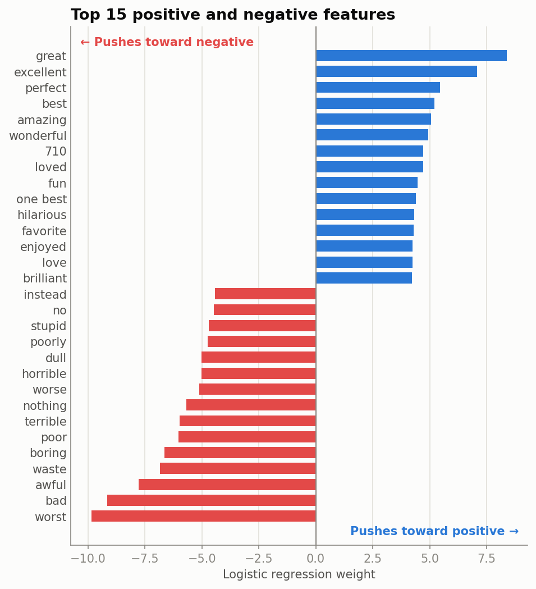
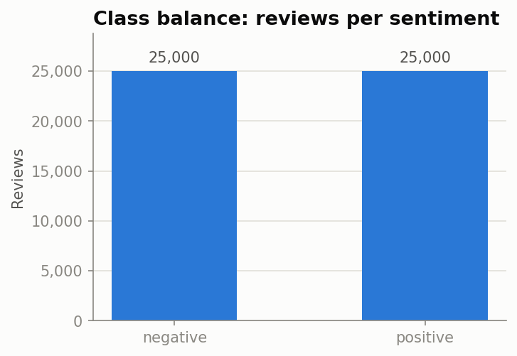

# IMDB Sentiment Analysis

A TF-IDF + Logistic Regression baseline reaches **90% accuracy** on 50,000 IMDB reviews. This project is about the other 10%: what the model gets wrong, why, and how much of it can be fixed at all.

## Key findings

### 1. A simple baseline gets to 90%

Unigram TF-IDF (20k features) with Logistic Regression scores **89.8%** test accuracy. No embeddings or deep learning needed. Any more complex model has to beat this number to justify its cost.

### 2. Bigrams helped, but not the way I expected

**Hypothesis:** I kept negations (`not`, `no`, `didn`, ...) when removing stopwords, so bigrams like `not good` should become usable features. If negation was the model's main weakness, bigrams should mostly improve **negative** recall.

**Result:** bigrams with a 50k vocabulary add **+0.85 points** of accuracy, but the gain is split evenly between the classes:

| Features | Test acc | Neg recall | Pos recall |
|---|---|---|---|
| Unigrams, 20k | 89.76% | 88.96% | 90.56% |
| Uni + bigrams, 20k | 90.33% | 89.52% | 91.14% |
| **Uni + bigrams, 50k** | **90.61%** | **89.84%** | **91.38%** |
| *Gain* | *+0.85* | *+0.88* | *+0.82* |

The hypothesis doesn't hold. Bigrams add general context (`one best`, `waste time`) that helps both classes equally. They don't specifically fix negation.



### 3. "So bad it's good" reviews fool a bag-of-words model

Several of the model's most confident false negatives are people who loved a film *because* it was terrible:

> *"This movie is horrible - in a 'so bad it's good' kind of way."* (labeled positive, model: 7% positive)

> *"There is a fine line between plain awful and absolutely hilarious and believe me this film is the latter."* (labeled positive, model: 7% positive)

The model sees `horrible`, `awful`, `bad acting` and has no way to tell they're meant affectionately. A keyword search finds this kind of phrasing (so bad it's good, guilty pleasure, cheesy, campy) in 41 of the 431 false negatives. Handling this requires a model that reads context, not a better bag of words.

### 4. Label noise sets a ceiling

Some confident "mistakes" aren't mistakes; the label is wrong:

> *"Great movie - especially the music - Etta James - 'At Last'."* (labeled **negative**)

> *"Ernest Borgnine was so wasted in this movie... DON'T WASTE THEM"* (labeled **positive**)

IMDB labels come from the reviewer's star rating, not the text, and sometimes the two disagree. At least 5 of the 30 most confident errors read as clearly the opposite of their label. No model can get these right, so part of the remaining 9.4% error is unfixable.

The model is also well aware of its uncertainty: only **104 of 939** errors had P(positive) above 0.8 or below 0.2. Most mistakes are on reviews that are genuinely mixed.

### 5. The model learned sensible features, plus one leak

The strongest features are what you'd expect (`great`, `excellent` vs. `worst`, `bad`, `waste`). Negative words carry larger weights than positive ones. One surprise: **`710` is a top positive feature**. It is "7/10" with the slash removed during punctuation cleaning, so reviewers' own scores leak into the text.



## Dataset

[IMDB Dataset of 50K Movie Reviews](https://www.kaggle.com/datasets/lakshmi25npathi/imdb-dataset-of-50k-movie-reviews) on Kaggle: 25,000 positive and 25,000 negative reviews, so accuracy is a fair metric. The split is 80/20, stratified.



The CSV (~60 MB) is not included in this repo. Download it from Kaggle and save it as `data/IMDB-Dataset.csv`.

## Preprocessing

1. Lowercase
2. Remove HTML tags (`<br />`) and URLs
3. Remove punctuation and collapse whitespace
4. Remove English stopwords, keeping negations

The raw review text is kept alongside the cleaned version, so error analysis shows what the reviewer actually wrote.

## Project structure

```
imdb-sentiment-analysis/
├── README.md
├── requirements.txt
├── .gitignore
├── notebooks/
│   ├── 01_eda_preprocessing.ipynb           # load, class balance, text cleaning, save cleaned CSV
│   └── 02_modeling_and_error_analysis.ipynb  # TF-IDF + LogReg, n-gram experiments, error analysis
└── images/
    ├── class_balance.png
    ├── ngram_comparison.png
    └── top_features.png
```

## How to run

```bash
pip install -r requirements.txt
```

Run the notebooks in order from the `notebooks/` folder. Notebook 01 writes `data/imdb_clean.csv`, which notebook 02 reads.

## What I'd try next

- **Tune on a validation set.** The n-gram configurations were compared on the test set; cross-validating `C` and the vocabulary size would give an unbiased final number.
- **Keep rating patterns out of the features.** Strip or normalize scores like "7/10" before punctuation removal, so the model learns from language rather than leaked ratings.
- **Fine-tune a transformer** (e.g. DistilBERT). The "so bad it's good" errors are exactly what contextual models should handle. The label noise shows the realistic ceiling to expect.
